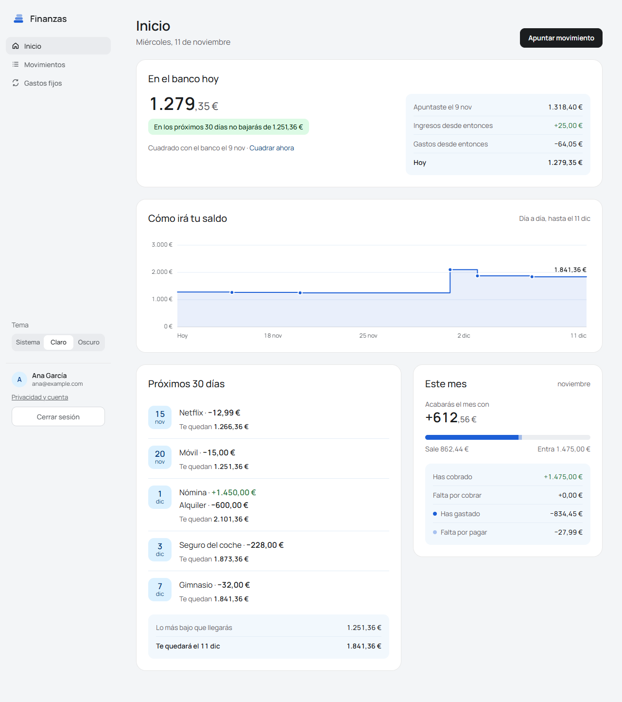
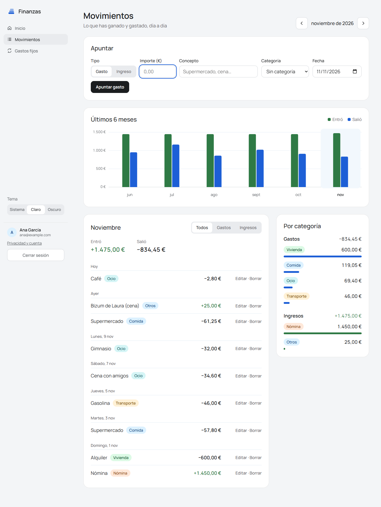
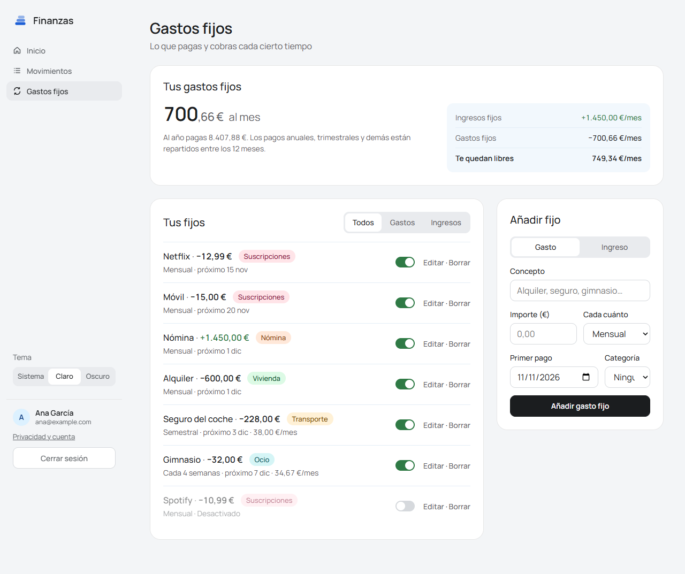
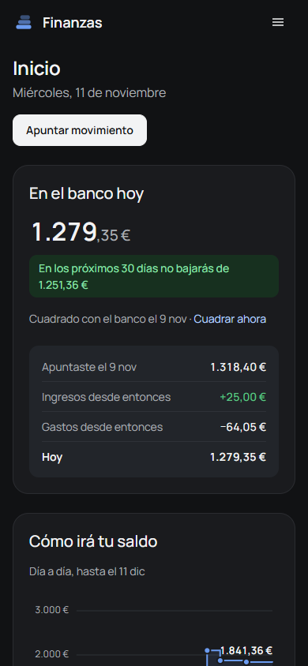

# Finanzas

App web para controlar tu dinero: lo que entra, lo que sale y los pagos que se repiten (nómina, alquiler, suscripciones). Te avisa antes de que llegue el día en que te quedarías en negativo.

**Pruébala:** https://finanzas-mark.netlify.app (entras con tu cuenta de Google)

> La API está en el plan gratis de Render, que la apaga tras 15 minutos sin uso. Si nadie la ha usado en un rato, la primera vez tarda 2 o 3 minutos en arrancar; la web lo avisa y reintenta sola.



<sub>Las capturas usan datos inventados.</sub>

## Qué hace

- **Saldo de hoy y previsión día a día.** Le dices cuánto tienes en el banco y calcula cuánto te quedará cada día de los próximos 30, contando los pagos fijos. Si algún día bajas de 0, te avisa en rojo y te dice cuál.
- **Movimientos.** Apuntas gastos e ingresos con categoría y fecha, los ves agrupados por día, filtras por mes y los editas si te has equivocado.
- **Gastos fijos.** Pagos que se repiten cada semana, cada 4 semanas, cada mes, cada 2, 3 o 6 meses o cada año. Te dice cuánto suponen al mes y al año y cuándo toca el siguiente. Se pueden editar o pausar con un interruptor.
- **Resumen del mes.** Lo que ha entrado y salido, por categoría, con gráficos de los últimos meses.
- **Cuentas de usuario.** Login con Google, sin contraseñas. Cada usuario ve solo sus datos y puede borrar su cuenta con todo lo que tenga.
- **Tema claro y oscuro**, y se usa bien en el móvil.

## Capturas

**Movimientos:** apuntar, gráfico de los últimos 6 meses, lista del mes y gasto por categoría.



**Gastos fijos:** cuánto suponen al mes, la lista con su próxima fecha y el formulario para añadir.



**En el móvil, con el tema oscuro:**



## Cómo está hecha

```
Navegador ──> Netlify ──/api──> Render ──> Neon
              (web React)       (API Java      (PostgreSQL)
                                 en Docker)
                    ▲
          Login con Google
```

Netlify sirve la web y reenvía todo lo que empieza por `/api` a la API, así el navegador lo ve todo en la misma dirección y no hace falta configurar CORS.

| Parte | Tecnologías |
|---|---|
| API | Java 21, Spring Boot 4, Spring Data JPA, Spring Security (OAuth2 Resource Server), Bean Validation |
| Base de datos | PostgreSQL 18, migraciones con Flyway |
| Web | React 19, TypeScript, Vite. Sin librerías de componentes ni de gráficos: los gráficos son SVG hechos a mano |
| Tests | JUnit 5, MockMvc, H2 en memoria (119 tests) |
| Despliegue | Docker, Render (API), Neon (base de datos), Netlify (web) |

### Algunas decisiones

- **El dinero nunca es `double`.** En Java es `BigDecimal` y en la base de datos `NUMERIC(12,2)`, para no perder céntimos por redondeos.
- **Login con Google + JWT propio.** La web obtiene un token de Google; la API comprueba su firma con las claves públicas de Google (y que va dirigido a esta app y el email está verificado) y devuelve su propio JWT de 7 días. Así la API no guarda contraseñas y el resto de peticiones no dependen de Google.
- **Datos separados por usuario.** Todas las tablas tienen `usuario_id` y cada consulta filtra por el usuario del token. Hay un test con dos usuarios que comprueba que uno no puede leer, cambiar ni borrar lo del otro.
- **La fecha de "hoy" se inyecta** (`Clock`) para que los tests de la previsión no dependan del día en que se ejecutan.
- **Nunca se modifica una migración ya aplicada.** Cada cambio de tablas es una migración nueva (V1 a V8).
- **Los secretos van en variables de entorno**, nunca en el código.

## Seguridad

La app está abierta a cualquiera con una cuenta de Google, así que está pensada para que nadie pueda ver ni romper lo de otro.

| Riesgo | Cómo se evita |
|---|---|
| Ver o cambiar los datos de otro usuario | Todas las consultas filtran por el usuario del token. `SeparacionDeUsuariosTest` comprueba con dos usuarios que uno no puede leer, cambiar ni borrar nada del otro |
| Entrar con una cuenta de Google falsa | La API comprueba la firma del token de Google con sus claves públicas, que vaya dirigido a esta app (`aud`) y que el email esté verificado |
| Falsificar o reutilizar una sesión | JWT firmado con HS256 y una clave de al menos 32 caracteres que solo existe en el servidor. Caduca a los 7 días y deja de valer al momento si el usuario borra su cuenta |
| Robo de contraseñas | No hay contraseñas: el login es solo con Google |
| Inyección SQL | Spring Data JPA con consultas parametrizadas |
| Datos absurdos (textos enormes, importes gigantes, rangos de fechas sin fin) | Bean Validation en cada petición y límites en los parámetros; la API responde 400 |
| Código malicioso en la web (XSS) | React escapa todo lo que pinta y la web manda una **Content Security Policy** que solo deja cargar código, estilos e imágenes de la propia web y de Google |
| Meter la web en un marco de otra para engañar al usuario (clickjacking) | `frame-ancestors 'none'` y `X-Frame-Options: DENY` |
| Llenar la base de datos para tirar la app a todos | Límite por usuario: 20.000 movimientos, 100 categorías, 200 gastos fijos y 5.000 saldos. Al llegar, la API responde 409 con un mensaje claro |
| Que otra web llame a la API desde el navegador | Sin CORS abierto: el navegador lo bloquea. La web llega a la API a través del proxy de Netlify, en la misma dirección |
| Escuchar la conexión | Todo va por HTTPS, con HSTS |

Además, la API corre en Docker con un usuario sin permisos de administrador, y `npm audit` no encuentra vulnerabilidades en las dependencias de la web.

## Arrancarla en tu ordenador

Necesitas Java 21, Node.js y PostgreSQL 18 (o Docker).

### 1. Variables de entorno

| Variable | Para qué | Ejemplo |
|---|---|---|
| `DB_PASSWORD` | Contraseña de tu PostgreSQL | la tuya |
| `JWT_SECRET` | Clave para firmar las sesiones, de al menos 32 caracteres | una cadena aleatoria larga |
| `DB_URL` y `DB_USER` | Opcionales. Por defecto `jdbc:postgresql://localhost:5432/finanzas` y `postgres` | |

### 2. La API

Crea una base de datos vacía llamada `finanzas` en PostgreSQL. Flyway crea las tablas al arrancar.

```bash
./mvnw spring-boot:run      # en Windows: mvnw.cmd spring-boot:run
```

La API queda en http://localhost:8080.

**Con Docker**, en lugar de instalar PostgreSQL (solo necesitas `JWT_SECRET`):

```bash
docker compose up --build
```

### 3. La web

```bash
cd web
npm install
npm run dev
```

Abre http://localhost:5173. Vite reenvía `/api` al puerto 8080.

### Tests

```bash
./mvnw test
```

Usan H2 en memoria, así que no necesitan PostgreSQL ni Google.

## API

Todas las rutas piden `Authorization: Bearer <token>` salvo `POST /api/auth/google`.

| Ruta | Qué hace |
|---|---|
| `POST /api/auth/google` | Cambia el token de Google por una sesión de la app |
| `GET` / `DELETE /api/auth/yo` | Ver tu cuenta / borrarla con todos tus datos |
| `/api/movimientos` | CRUD de movimientos |
| `/api/categorias` | CRUD de categorías |
| `/api/pagos-recurrentes` | CRUD de gastos fijos; `/proximos?desde=&dias=` lista los próximos pagos |
| `GET /api/resumen?mes=AAAA-MM` | Totales del mes por categoría |
| `GET /api/prevision` | Cómo acabará el mes con lo apuntado y los pagos que faltan |
| `/api/saldo-banco` | Guardar el saldo de hoy, historial y `/prevision?dias=` día a día |

## Estructura

```
src/main/java/.../finanzas/
  movimiento/  categoria/  pagorecurrente/  banco/    cada parte con su controller, service, repository y entidad
  resumen/  prevision/                                cálculos del mes
  seguridad/  usuario/                                login con Google, JWT y cuentas
src/main/resources/db/migration/                      migraciones de Flyway (V1 a V8)
web/src/
  pantallas/     Inicio, Movimientos, Gastos fijos, Entrar, Privacidad
  componentes/   tarjetas, formularios, listas y gráficos
  api.ts         llamadas a la API (token, reintentos si está dormida)
```
